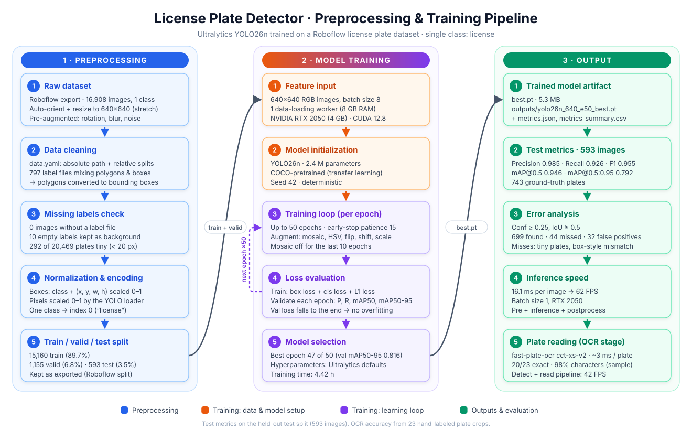

# PlateScan — AI-Based License Plate Recognition

A two-stage automatic license plate recognition (ALPR) system with a web dashboard:

```
Image ─► YOLO26n plate detector ─► plate crop ─► fast-plate-ocr ─► "ABC 1234" ─► format check + SQLite log
```

- **Detector:** Ultralytics YOLO26n fine-tuned on ~16,900 license plate images.
- **Reader:** [fast-plate-ocr](https://github.com/ankandrew/fast-plate-ocr) (`cct-xs-v2-global-model`), a pretrained plate-specific OCR model.
- **Dashboard:** one web page (`platescan/static/index.html`) — camera capture or image upload, plate reading, preprocessing views, model metrics, and a searchable vehicle log with CSV export. It runs identically in two ways: as a **Streamlit app** (`streamlit_app.py`, deployable on Streamlit Community Cloud) or with a local **FastAPI** server (`platescan/server.py`). Both use one shared pipeline (`platescan/pipeline.py`).



## Results

| Stage | Metric | Result |
|---|---|---|
| Plate detection (test split, 593 images) | Precision / Recall / F1 | 0.985 / 0.926 / 0.955 |
| | mAP@0.5 / mAP@0.5:0.95 | 0.946 / 0.792 |
| Plate reading (23 hand-labeled crops) | Plates exact / characters correct | 20/23 (87%) / 98.0% |
| Speed (NVIDIA RTX 2050 laptop GPU) | Detector / full pipeline | 65 FPS / 42 FPS |

Detection recall is 96–99% for plates at least 40 px tall (at 640 px) and drops sharply below 20 px. Full analysis: [`RESULTS_DOCUMENTATION.md`](RESULTS_DOCUMENTATION.md) · project write-up: [`PROJECT_DOCUMENTATION.md`](PROJECT_DOCUMENTATION.md).

## Repository structure

```
AI_PlateNumber.py          Detector pipeline: setup, data checks/repair, training, evaluation, speed (Parts 1-10)
AI_PlateNumber_OCR.py      Reader pipeline: detect + crop + OCR, test-set run, manual accuracy check (Parts 1-8)
streamlit_app.py           Streamlit host: shows the dashboard page as a component (local or Streamlit Cloud)
platescan/pipeline.py      Shared pipeline: models, recognition, PH format check, SQLite log, metrics
platescan/server.py        FastAPI host: POST /predict, /metrics, /log, /log.csv
platescan/static/index.html  The dashboard page (used by both hosts)
packages.txt, .streamlit/  System packages and theme for Streamlit Cloud
models/yolo26n_640_e50_best.pt  Trained plate detector (5.3 MB)
scripts/make_report_figures.py  Charts and extra analyses for RESULTS_DOCUMENTATION.md
requirements.txt
```

Not in the repository (created locally): `data/` (dataset), `plate_detection/` (training runs, evaluation outputs, OCR crops, figures), `platescan/platescan.db` (vehicle log).

## Setup

1. **Python packages**
   ```bash
   pip install torch torchvision --index-url https://download.pytorch.org/whl/cu128   # GPU build of PyTorch
   pip install -r requirements.txt
   ```
2. **Dataset** (only needed for training/evaluation, not for the dashboard): download
   [License Plate Detection MERGED PROJECTS v3](https://universe.roboflow.com/university-of-southeastern-philippines-cnl9c/license-plate-detection-merged-projects/dataset/3)
   from Roboflow Universe in **YOLO26** format and extract it to:
   ```
   data/License Plate Detection MERGED PROJECTS.v3-best-model.yolo26/
   ```

## Usage

Run all commands from the repository folder.

**Streamlit dashboard**
```bash
streamlit run streamlit_app.py
```
Opens <http://localhost:8501> with the PlateScan dashboard. Use *Live camera* or *Upload image*. The first start downloads the COCO-pretrained `yolo26n.pt` (vehicle detection) and the OCR model.

**Deploy on Streamlit Community Cloud** — at [share.streamlit.io](https://share.streamlit.io): *Create app* → repository `rrosoidea-commits/PlateScan`, branch `main`, **main file path `streamlit_app.py`**, and in *Advanced settings* choose **Python 3.12**. The cloud runs on CPU (~0.1–1 s per image); the vehicle log is per browser session and resets when the app restarts.

**FastAPI dashboard** (local alternative, same page)
```bash
python platescan/server.py
```
Open <http://127.0.0.1:8000>. Use *Live camera* (browser permission needed) or *Upload image*. Press `Ctrl+C` in the terminal to stop.

**Train and evaluate the detector**
```bash
python AI_PlateNumber.py
```
Training (~4.4 h on an RTX 2050) is skipped when `plate_detection/runs/yolo26n_640_e50/weights/best.pt` already exists (`RETRAIN` / `RESUME` flags at the top of the file). After retraining, copy `plate_detection/outputs/yolo26n_640_e50_best.pt` to `models/` to use it in the OCR script and dashboard.

**Read plates on the test set**
```bash
python AI_PlateNumber_OCR.py
```
To measure OCR accuracy, fill in `correct_text` in `plate_detection/ocr_outputs/manual_check.csv` and run the script again.

**Report charts**
```bash
python scripts/make_report_figures.py
```

## Notes and limitations

- Philippine plate formats checked by the dashboard (`ABC 1234`, `ABC 123`, `123 ABC`) should be verified against current LTO rules (`PH_FORMATS` in `platescan/server.py`).
- Very small plates (< 20 px tall at 640 px) are rarely detected or read; position the camera so plates appear larger.
- On Windows with 8 GB RAM, training uses `WORKERS = 1` to avoid a paging-file crash (see `PROJECT_DOCUMENTATION.md`).
- License plates are personal data: the dashboard processes images locally and stores the log only on the local machine.

## Credits

- Dataset: *License Plate Detection MERGED PROJECTS* (Roboflow Universe, University of Southeastern Philippines workspace), CC BY 4.0.
- [Ultralytics YOLO](https://github.com/ultralytics/ultralytics) (AGPL-3.0) · [fast-plate-ocr](https://github.com/ankandrew/fast-plate-ocr) · [FastAPI](https://fastapi.tiangolo.com/)
